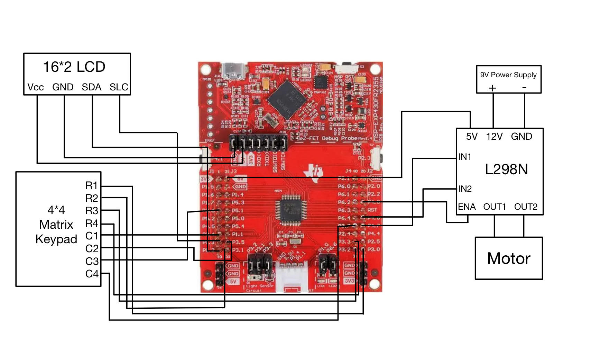

# MSP430 PWM Motor Control

DC motor speed control using an MSP430, a 4x4 keypad, a 16x2 I2C LCD, and a motor driver. Enter a speed percentage on the keypad and press `#` to apply it.

[Watch the original circuit demo](https://youtu.be/mdbq6Uu_s7I)

## Wiring

The keypad connects to Port 3, the I2C LCD uses address `0x27`, and the L298N drives the DC motor. The controller and motor driver share ground.

## How it works

- Scan a 4x4 keypad and debounce key presses.
- Accept a speed from 0 to 100 percent and apply it with `#`.
- Use Timer B interrupts to generate the motor-control PWM signal.
- Display the selected setting on the LCD.

## Build

Open `src/main.c` in a TI Code Composer Studio MSP430 C project with the `LiquidCrystal_I2C` library and appropriate device support. Connect the circuit following the wiring diagram.

`original/pwm_report_baseline.c` contains the recovered original program. The version in `src/` simplifies the keypad handling and handles 0% and 100% duty cycle settings.

## Background

Developed by Abdul Nafeh for an embedded systems project at the University of South Florida.
